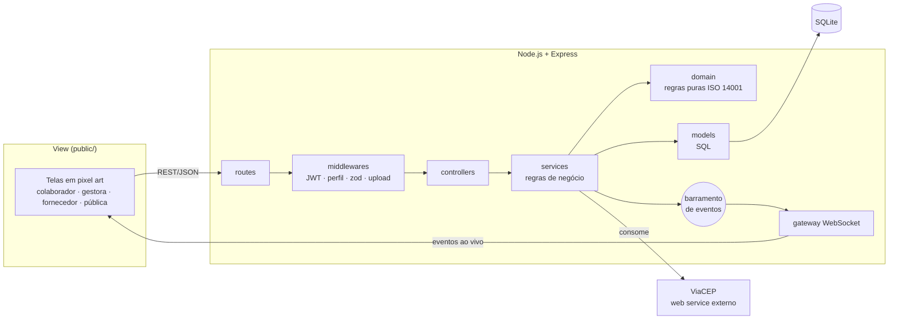

# Silvia

> *Silvia*, do latim **silva**: floresta, mata.

Plataforma gamificada de apoio ao **Sistema de Gestão Ambiental (ISO 14001)**, construída sobre **Web Services REST e WebSocket**. Projeto das Atividades Práticas Supervisionadas (APS) do 7º/8º semestre de Ciência da Computação, UNIP.

> **Sobre o histórico:** o Silvia foi desenvolvido originalmente em um repositório privado do grupo. Como o histórico daquele repositório acumulou problemas que dificultavam a manutenção, optamos por republicar o projeto aqui a partir de uma base limpa, já com as correções feitas depois da entrega. Por isso o histórico de commits começa neste repositório.

Cada colaborador cuida de uma **muda virtual** que só cresce com **ações ambientais reais e comprovadas**:

| No jogo | Na vida real | ISO 14001 |
|---|---|---|
| **Regar** | Registrar uma ação com evidência (foto ou PDF), validada pela gestora | 8.1, 7.5 |
| **Adubar** | Fazer microtreinamentos sobre a política e os aspectos ambientais | 7.2, 7.3 |
| **Podar** | Reportar um desperdício, que vira não conformidade com ação corretiva | 10.2 |
| **Sol** | Metas do setor medidas com dados reais (kWh, folhas, % reciclável) | 6.2, 9.1 |
| **Murchar** | Sem ações, a planta perde saúde e todos são avisados | 9.1, 10.3 |
| **Árvore real** | A cada 1.000 pontos do setor, a empresa planta uma árvore nativa | 7.4, 4.2 |

Grupo: **Higor** (back-end, banco e infraestrutura) · **Breno** (front-end) · **João** (regras de gamificação e tempo real).

---

## Como rodar

Pré-requisito: **Node.js 22.13 ou mais novo** (usa o SQLite embutido no Node; não precisa instalar banco).

```bash
npm install          # instala as dependências
npm start            # sobe o servidor em http://localhost:3000
```

Na primeira execução o banco é criado em `data/silvia.db` e populado com dados de demonstração.

| Endereço | O que é |
|---|---|
| http://localhost:3000 | Aplicação (login, área logada e página pública) |
| http://localhost:3000/api/docs | Documentação interativa da API (Swagger) |
| http://localhost:3000/api/openapi.json | Especificação OpenAPI 3 |
| ws://localhost:3000/tempo-real | Canal WebSocket de tempo real |

### Contas de demonstração (senha `silvia123`)

| Perfil | E-mail |
|---|---|
| Colaborador | `higor@silvia.local`, `breno@silvia.local`, `joao@silvia.local`, `ana@silvia.local`... |
| Gestora ambiental | `marina@silvia.local` |
| Fornecedor | `embalasul@silvia.local`, `translog@silvia.local`, `graobom@silvia.local` |

A tela de login lista todas as contas; basta clicar numa delas.

### Outros comandos

```bash
npm run dev               # servidor reinicia sozinho ao salvar arquivos
npm test                  # roda os testes automatizados
npm run test:cobertura    # testes com relatório de cobertura
npm run lint              # análise estática (ESLint)
npm run db:seed           # apaga o banco e recria os dados de demonstração
```

### Configuração (opcional)

Copie `.env.example` para `.env`. Principais variáveis:

- `PORTA`: porta HTTP (padrão 3000).
- `JWT_SEGREDO`: segredo dos tokens. **Troque em produção.**
- `CICLO_DIARIO_HORA`: hora em que roda o decaimento diário das plantas.

---

## Arquitetura



Detalhes em [docs/arquitetura.md](docs/arquitetura.md).

## Estrutura de pastas

```
silvia/
├── src/                      Back-end (API REST + WebSocket)
│   ├── server.js             Ponto de entrada: HTTP, WebSocket e agendador
│   ├── app.js                Montagem do Express (segurança, Swagger, rotas)
│   ├── config/               Configuração via variáveis de ambiente
│   ├── routes/               Rotas REST v1 (C do MVC: roteamento)
│   ├── controllers/          Controllers finos: HTTP → serviço
│   ├── services/             Regras de negócio e orquestração
│   ├── domain/               Regras puras do jogo (testadas isoladamente)
│   ├── models/               Acesso a dados (M do MVC)
│   ├── views/                Documentos gerados no servidor (relatório HTML, CSV)
│   ├── validators/           Esquemas de validação (zod)
│   ├── middlewares/          Autenticação, autorização, upload e erros
│   ├── realtime/             Barramento de eventos e gateway WebSocket
│   ├── integrations/         Cliente do ViaCEP
│   ├── jobs/                 Agendador do ciclo diário
│   ├── database/             Conexão, migrações SQL e dados de demonstração
│   └── docs/openapi.yaml     Especificação da API
├── public/                   Front-end (V do MVC), sem build
│   ├── index.html
│   ├── css/silvia.css
│   └── js/
│       ├── main.js           Rotas, sessão e blocos com atualização ao vivo
│       ├── core/             Cliente da API, WebSocket, desenho das plantas, UI
│       └── views/            Telas por perfil
├── tests/                    Testes unitários e de integração (node:test)
└── docs/                     Documentação técnica
```

## Documentação

- [Arquitetura e decisões técnicas](docs/arquitetura.md)
- [Regras de negócio e ligação com a ISO 14001](docs/regras-de-negocio.md)
- [API REST e eventos WebSocket](docs/api.md)
- [Banco de dados](docs/banco-de-dados.md)
- [Testes](docs/testes.md)

## Licença

MIT. Projeto acadêmico.
