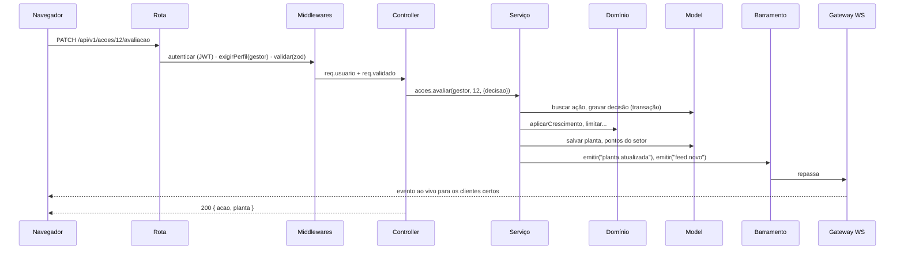
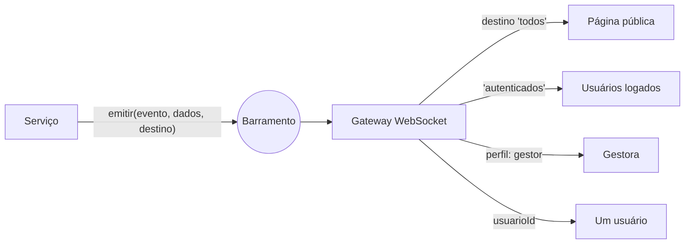

# Arquitetura

## Visão geral

O Silvia é uma aplicação **cliente-servidor** em que o servidor expõe **web services** em dois estilos complementares:

- **REST sobre HTTP** (JSON): operações de leitura e escrita (`/api/v1/...`), documentadas em OpenAPI 3 e testáveis pelo Swagger UI.
- **WebSocket** (`/tempo-real`): o servidor *empurra* eventos para os clientes (feed, plantas, notificações), sem o cliente precisar perguntar.

Além de **fornecer** web services, o sistema também **consome** um web service externo: o **ViaCEP**, para completar o endereço dos plantios.

## Padrão arquitetural: MVC com camada de serviços

| Camada | Pasta | Responsabilidade |
|---|---|---|
| **Model** | `src/models/` | Acesso a dados. Só SQL e conversão de linhas em objetos. Nenhuma regra de negócio. |
| **View** | `public/` e `src/views/` | Interface do usuário (SPA em JavaScript) e documentos gerados no servidor (relatório HTML, CSV). |
| **Controller** | `src/controllers/` + `src/routes/` | Recebe a requisição já autenticada e validada, chama o serviço e escolhe o status HTTP. |
| Serviços | `src/services/` | Regras de negócio e orquestração: transações, feed, auditoria, notificações e eventos. |
| Domínio | `src/domain/` | Regras puras do jogo (saúde, sol, crescimento, decaimento). Sem banco, sem HTTP. |

O MVC clássico concentra regra no Model ou no Controller. Aqui a regra fica numa **camada de serviços** e num **domínio puro**, o que mantém controllers finos e permite testar as fórmulas sem subir servidor.

### Caminho de uma requisição

## Decisões técnicas

| Decisão | Motivo |
|---|---|
| **Node.js 22 + Express 5** | Mesma linguagem no front e no back; Express 5 trata erros de funções assíncronas sozinho. |
| **SQLite embutido (`node:sqlite`)** | Banco relacional real, com chaves estrangeiras e `CHECK`, sem servidor separado e sem dependência nativa para compilar. |
| **Migrações em SQL puro** | O esquema fica legível e versionado (`src/database/migracoes`). |
| **JWT** | Autenticação sem estado, adequada a web services; o mesmo token autentica REST e WebSocket. |
| **zod** | Validação declarativa das entradas com mensagens em português. |
| **WebSocket (`ws`)** | Protocolo padrão (RFC 6455), sem biblioteca no navegador. |
| **Barramento de eventos** | Serviços publicam fatos ("planta atualizada"); o gateway decide quem recebe. Regra de negócio não conhece transporte. |
| **Injeção de dependências manual** | `criarApp({db, config, viacep})`: os testes trocam o banco por memória e os serviços externos por versões falsas. |
| **Front-end sem build** | Módulos ES nativos do navegador; qualquer integrante abre e entende o código. |
| **OpenAPI 3 + Swagger UI** | Documentação navegável e testável dos web services. |

## Segurança

- Senhas guardadas com **bcrypt**; o hash nunca sai da API.
- **JWT** com expiração (`JWT_EXPIRACAO`); perfis verificados em cada rota (`exigirPerfil`).
- Uploads limitados a imagens e PDF de até 8 MB, salvos com nome aleatório (UUID).
- Evidências só podem ser baixadas pelo autor ou pela gestora.
- **Helmet** com Content Security Policy restritiva; o front não usa scripts inline.
- Sem login, rotas da API respondem 401 antes de revelar se existem.
- Toda alteração relevante vai para a **trilha de auditoria**.

## Tratamento de erros

Toda falha vira `{ "erro": { "codigo", "mensagem", "detalhes" } }` com status coerente:

| Status | Quando |
|---|---|
| 400 | JSON malformado, CEP com formato inválido |
| 401 | Sem token, token inválido ou expirado, senha errada |
| 403 | Perfil sem permissão (ex.: colaborador tentando validar) |
| 404 | Recurso ou rota inexistente |
| 409 | Transição inválida (avaliar duas vezes, fechar NC não aceita) |
| 413 | Arquivo acima de 8 MB |
| 422 | Dados inválidos (zod), evidência ausente, CEP inexistente, eficácia não verificada |

Se o **ViaCEP** estiver fora do ar, o plantio é registrado assim mesmo, marcado como "endereço não verificado": o sistema degrada sem travar.

## Tempo real

No navegador, cada tela é composta de **blocos**. Cada bloco declara quais eventos o interessam (ex.: o canteiro escuta `planta.atualizada`) e se redesenha sozinho, sem apagar formulários abertos. A conexão reconecta automaticamente.
