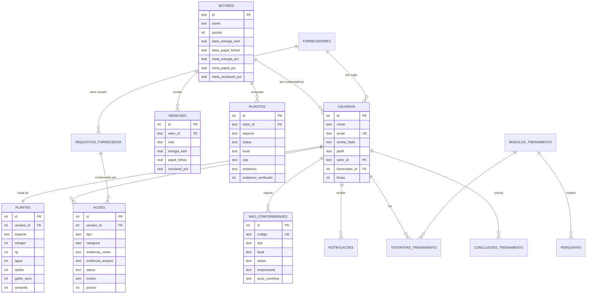

# Banco de dados

SQLite (módulo nativo `node:sqlite` do Node 22). O esquema está em `src/database/migracoes/001_esquema_inicial.sql` e é aplicado por `src/database/migrar.js`, que registra cada migração na tabela `_migracoes`.

Regras de integridade ficam no próprio banco: chaves estrangeiras ligadas, `CHECK` em status, faixas (0–100, estágio 0–4) e formato de mês (`AAAA-MM`), e `UNIQUE` onde há unicidade (uma medição por setor e mês, uma planta por usuário, código de NC).

## Modelo entidade-relacionamento



Tabelas auxiliares: `feed` (itens do "Acontecendo agora"), `auditoria` (trilha 9.2) e `notificacoes`.

## Tabelas e requisitos da norma

| Tabela | Para que serve | ISO 14001 |
|---|---|---|
| `setores`, `medicoes` | Linha de base, metas e medições mensais | 6.2, 9.1 |
| `acoes` | Ações ambientais com evidência e decisão | 8.1, 7.5 |
| `nao_conformidades` | Desperdícios e ações corretivas | 10.2 |
| `modulos_treinamento`, `perguntas`, `tentativas_treinamento`, `conclusoes_treinamento` | Treinamentos | 7.2, 7.3 |
| `plantios` | Árvores reais | 7.4 |
| `fornecedores`, `requisitos_fornecedor` | Requisitos para provedores externos | 8.1 |
| `auditoria` | Rastreabilidade de tudo que muda | 9.2 |

## Comandos

```bash
npm run db:migrar   # aplica migrações pendentes no banco configurado
npm run db:seed     # apaga e recria o banco com dados de demonstração
```

Para mudar o esquema, crie um novo arquivo `002_descricao.sql` em `src/database/migracoes/`. Nunca edite uma migração já aplicada.
